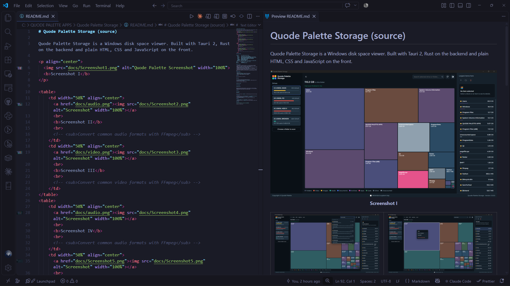

# Quode Palette MD Preview

A fast Markdown preview for VS Code. It opens beside your editor, updates as you type, and scrolls both sides simultaneously.

<p align="center">
  
  <b>Screenshot</b>
</p>

## Features

- **Live preview.** Changes show up as you type.
- **Synced scrolling.** Scroll the editor and the preview follows. Scroll the preview and the editor follows.
- **Three themes.** Right-click inside the preview and pick Light, Dark or VS Code. The VS Code option matches your current theme, and your choice is remembered.
- **Images that just work.** Relative paths, paths from the workspace root, and images placed with HTML tags all load.
- **The basics, done well.** Syntax highlighted code blocks, tables, task lists, heading links, and relative links to other Markdown files.

## Install

1. Download the latest `.vsix` file from the [Releases](../../releases) page.
2. In VS Code, open the Extensions view.
3. Click the `...` menu at the top and choose **Install from VSIX...**
4. Select the downloaded file and reload VS Code if asked.

You can also install from a terminal:

```
code --install-extension quode-palette-md-preview-1.0.0.vsix
```

## Use

Open a Markdown file, right-click in the editor and choose **Open Quode Palette Preview to the Side**.

The same command is also in the editor title bar, in the right-click menu for files in the Explorer, and in the Command Palette (search for "Quode Palette").

To change the theme, right-click anywhere in the preview.

## Good to know

- Images need to be inside your workspace folder or next to the Markdown file. VS Code does not let previews read files from other places.
- Remote images only load from `http` and `https` addresses.
- The preview is not restored after VS Code restarts. Just open it again.
- Mermaid diagrams and math are not supported yet.

## Feedback

Found a bug or have an idea? Email [hello@quodepalette.com](mailto:hello@quodepalette.com).

## License

Released under the [PolyForm Noncommercial License 1.0.0](LICENSE). You can use, modify and share it for personal, educational and other noncommercial purposes. For commercial use, please [get in touch](mailto:hello@quodepalette.com).
